# Groove architecture

Status: implemented development design. The v1 protocol is not yet formally
frozen. See [protocol](protocol.md), [operations](operations.md) and
[testing](testing.md) for the implemented interface and its validation limits.

See the [implementation plan](implementation-plan.md) for the target workspace,
ordered changes, and acceptance criteria for building this design.

## Scope and invariants

Groove manages a fixed number of reusable Git worktree slots for cooperative
agents and CI runners. The initial platform is Linux with local filesystems.

- Active lease ownership requires an exclusive `flock`. Durable reuse protection
  can additionally prohibit allocation after its owner exits.
- A worktree is handed out only after its requested baseline is verified.
- Slot lock files have permanent identities: never unlink or replace them.
- Metadata, PIDs, timestamps, and lease IDs never substitute for lock ownership.
- Cleanup affects only validated Groove-owned worktree paths.
- The lease must outlive every process that can write to its worktree.
- No daemon, global registry, heartbeat, or lease-expiration service is required.

`flock` is a Unix/BSD API, not a POSIX-standard API. Its lock belongs to an open
file description and is released when its last descriptor closes, or by explicit
unlock. Process termination closes that process's descriptors; copies held by
other processes can keep the lock alive.

## Components

| Component | Responsibility |
| --- | --- |
| Core library | `Pool`, `Lease`, options, results, and typed errors |
| Repository discovery | Resolve the common Git directory and managed paths |
| Allocator | Scan fixed slots, try nonblocking locks, and enforce wait deadlines |
| Ownership | Retain, transfer, validate, and release lease descriptors |
| Git backend | Create detached worktrees and perform normalization |
| Recovery | Inspect, repair or rebuild, verify, and quarantine failed slots |
| State store | Versioned metadata with atomic, durable writes |
| CLI | Argument parsing, JSON responses, and descriptor transport |

The CLI delegates to the library. The library does not print, configure global
logging, or require an async runtime.

## Repository-local storage

Metadata and lock files remain local to the common Git directory. `init` can
select a dedicated external checkout root; its absolute path and cleanup policy
are persisted in the manifest and cannot be changed implicitly.

Resolve the shared directory with:

```text
git -C <repo> rev-parse --path-format=absolute --git-common-dir
```

```text
<GIT_COMMON_DIR>/groove/
  config.json
  locks/
    admin.lock
    wt-0001.lock
    wt-0002.lock
  slots/
    wt-0001.json
    wt-0002.json
  worktrees/
    wt-0001/
    wt-0002/
  tmp/
```

Git retains its own standard worktree registrations under
`<GIT_COMMON_DIR>/worktrees/`. The locality requirement applies to Groove-owned
state; it does not relocate Git's native administration.

Initialize the fixed slot set eagerly and materialize worktrees lazily. Capacity
bounds leased slots and managed worktree directories, not disk usage.

The ready manifest records lock device/inode identities. Initialization intent
is published first so matching interrupted setup can resume and conflicting
setup fails. Managed roots reject symlink components and unsupported filesystem
types. Path safety assumes cooperating writers; this is not protection against
malicious same-user filesystem races.

Write metadata through a temporary file in the same filesystem, synchronize it,
rename it into place, and synchronize the containing directory. Never apply this
replacement protocol to lock files.

## Locking and ownership

Allocation uses `LOCK_EX | LOCK_NB` on a permanent slot lock file. A busy slot is
skipped. Waiting uses a monotonic deadline, bounded backoff, and a randomized
starting slot.

Hold the slot lock during inspection, sanitation, creation, handoff, and use.
Use `admin.lock` briefly for initialization and registration changes. After pool
initialization, acquire slot locks before the administrative lock whenever both
are needed. Do not hold the administrative lock while waiting for capacity.

The Rust library returns a non-Clone `Lease` with a private owned descriptor.
Dropping it closes the descriptor without running Git. Explicit release borrows
the lease mutably and invalidates it only on success; errors retain the handle.
Sanitation happens on the next acquisition. For an unprotected lease, closing the last descriptor is also
valid implicit release; release metadata is advisory.

The default CLI calls `Lease::into_protected`: persist durable reuse protection,
then close the kernel descriptor before returning JSON. Ordinary shell callers
can edit across independent calls without a daemon. `groove leases` lists these
reservations; explicit `release --writers-stopped` takes the slot lock and checks
the generation before removing protection. No command-exit or time-based expiry
permits reuse. Lost acquire responses require inspection; request IDs are not
idempotency keys. Completed release receipts allow same-generation retry only.

Descriptor-aware supervisors may opt into `--lease-channel-fd`, using an inherited
Unix `SOCK_SEQPACKET` socket and `SCM_RIGHTS`. That transport retains its original
last-descriptor-close lifetime for unprotected leases. The
[Rust reference client](../crates/groove-cli/examples/client.rs) demonstrates it.
In descriptor mode, the JSON-plus-descriptor message is authoritative; stdout
alone is not ownership. Abandoning callers close the channel and received descriptors.
The optional [MCP adapter](mcp.md) holds descriptors and durable protections for
clients that prefer structured tools.

The caller must stop all writers before explicit release. Surviving workers must
either retain duplicate lease descriptors or be terminated by their supervisor
before ownership is relinquished. Groove's mutating Git subprocesses must retain
the relevant descriptors so a killed Groove process cannot expose a slot while
its Git child is still modifying it.

Descriptor inheritance is deliberate and close-on-exec is the default. A daemon
or watcher retaining a copy can keep a slot busy indefinitely. A writer closing
its copy while continuing to run can instead outlive protection. The worker helper
uses a dedicated process group and waits for its direct child; detached descendants
remain the caller's responsibility. Process groups are not containment.
Explicit unlock affects all duplicate descriptors, so it must follow termination
of every writer. Optional `/proc` process enumeration is deferred and can never
replace flock as the authority; see [operations](operations.md).

## Acquisition and recovery

1. Resolve the requested revision to a full commit OID.
2. Obtain an exclusive slot lock.
3. Validate the managed path and Git registration.
4. Create an absent worktree, or inspect an existing one.
5. Normalize the index and working tree and establish detached HEAD at the OID.
6. Verify the baseline and absence of residual state.
7. Persist a fresh lease ID and hand ownership to the client.

For an otherwise healthy worktree, discard the owned worktree's index to remove
flags and stat-cache assumptions, then run:

```text
git -C <worktree> checkout --detach --force <OID> --
git -C <worktree> clean -ffdx
```

Forced checkout resets staged and working-tree changes without a redundant
restore. The second `-f` permits removal of untracked nested repositories.
`pristine` is the default and uses `-ffdx`; opt-in `warm` uses `-ffd` and retains
ignored files in healthy trees. Warm state is unverified and may be lost on rebuild.
This destructive behavior is limited to Groove's disposable worktrees. Native Git
registrations are created with `--lock` against external pruning, independently
of the flock lease.

Normalize on every acquisition. Status inspection is diagnostic, not proof that
normalization can be skipped. Verify detached HEAD, index and tracked contents,
absence of nonignored untracked files (and ignored files in pristine mode), valid
registration, and absence of interrupted Git operations. Baseline contents follow
controlled Git checkout semantics, including attributes/line-ending conversion;
they are not necessarily byte-for-byte raw blobs. Shared branches created by
agents survive cleanup and remain the caller's responsibility.

Rebuild interrupted or damaged worktrees under their slot lock and the
administrative lock. Remove the old worktree before creating its replacement.
If recovery fails, quarantine the slot, close its descriptor, and try another.
A later acquisition may retry recovery. Never hand out an unverified worktree.

Reject submodules, sparse checkout, configured checkout filters and worktree-specific
configuration. Run Git with argv arrays,
captured output, bounded execution, disabled interactive behavior, controlled
repository-selection environment variables, and hooks disabled for Groove's
maintenance operations. System/global Git configuration is disabled. Capture at
most 1 MiB per output stream while continuing to drain both streams concurrently;
oversized ordinary output fails explicitly. Recursive tree validation scans every
NUL-delimited record for gitlinks while retaining only bounded diagnostics, so
repository size does not impose an output-buffer limit on that scan.
Timeout handling terminates the dedicated
mutation process group and reaps the direct child before relinquishing protection.
Registration-mutating children inherit both slot and administrative descriptors.

```mermaid
stateDiagram-v2
    [*] --> available
    available: Unlocked, contents unverified
    quarantined: Unlocked, recovery required
    protected: Reuse blocked until explicit stopped-writer release

    available --> owned: Exclusive flock succeeds
    quarantined --> owned: Retry obtains flock

    state owned {
        [*] --> inspecting
        inspecting --> creating: Worktree absent
        inspecting --> sanitizing: Worktree present
        inspecting --> rebuilding: Invalid registration
        creating --> verifying: Checkout created
        sanitizing --> verifying: Cleanup completed
        sanitizing --> rebuilding: Interrupted or damaged state
        rebuilding --> verifying: Replacement created
        verifying --> leased: Checks pass and ownership transfers
        leased --> releasing: Explicit release
    }

    owned --> available: Last descriptor closes (unprotected)
    owned --> protected: Descriptor closes with reuse protection
    protected --> releasing: Stop writers; verify lock and generation
    releasing --> available: Unlock after writers stop
    creating --> quarantined: Provisioning fails
    rebuilding --> quarantined: Recovery fails
    verifying --> quarantined: Verification fails
```



## Proposed machine interface

The v1 command surface is limited to `init`, `acquire`, and `release`. Task
execution, task logs, and result preservation belong to the caller. Commands
such as `run` and `status` are deferred.

```text
groove --repo <PATH> [--request-id <ID>] init --capacity <N>
  [--cleanup pristine|warm] [--worktree-root <PATH>]

groove --repo <PATH> [--request-id <ID>] acquire
  [--base <REV>] [--wait-ms <MS>] [--lease-channel-fd <FD>]

groove --repo <PATH> leases

groove --repo <PATH> [--request-id <ID>] release
  --slot <SLOT_ID> --lease-id <UUID> (--writers-stopped | --lease-fd <FD>)
```

`init` is idempotent for identical configuration. A capacity, root or policy mismatch is an error;
resizing is outside the initial command surface. Interrupted initialization is
resumable, and the ready configuration is published only after durable setup.

`acquire` defaults to a zero-millisecond capacity wait. Git operation timeouts are
separate. Default success returns durable reservation metadata on stdout.
Opt-in descriptor mode transfers exactly one descriptor with its JSON record and
repeats the JSON on stdout. The payload identifies the slot, lease UUID, absolute
path, base OID, detached HEAD mode, and recovery outcome.

`release` requires matching slot and lease identities plus stopped-writer
confirmation for durable reservations, or the inherited descriptor in transport mode. It records release and explicitly unlocks. It neither commits nor
exports task results; clients must preserve those before release. The caller
invalidates its local handle following success.

Every normal command produces one newline-terminated JSON response on stdout.
Stderr is empty by default; `-v` mirrors debug events and `-vv` includes trace detail. Help,
argument errors, version output, and Git failures also use JSON.
Captured Git subprocess output must never leak directly into stdout; include
relevant failure details in the error response. Logging omits raw subprocess output.

```typescript
type Response<T> =
  | { api_version: 1; request_id: string | null; ok: true; result: T }
  | {
      api_version: 1;
      request_id: string | null;
      ok: false;
      error: {
        code: string;
        message: string;
        retryable: boolean;
        details: object;
      };
    };
```

Request IDs provide correlation, not idempotency. Lease IDs distinguish
acquisitions, but do not replace descriptors or fence arbitrary filesystem I/O.

| Exit | Error codes |
| --- | --- |
| 0 | Success |
| 2 | `INVALID_ARGUMENT`, `UNSUPPORTED_CONFIGURATION` |
| 3 | `POOL_EXHAUSTED`, `ACQUIRE_TIMEOUT` |
| 4 | `NOT_INITIALIZED`, `CONFIG_CONFLICT`, `INVALID_REVISION` |
| 5 | `INVALID_LEASE`, `LEASE_MISMATCH` |
| 6 | `RECOVERY_FAILED`, `POOL_UNHEALTHY` |
| 7 | `IO_ERROR`, `GIT_ERROR`, `PROTOCOL_ERROR` |

## Rust stack

- Installed Git via `std::process::Command` for the initial backend.
- Small `libc` syscall boundaries with owned Rust descriptors for flock and transport.
- `clap` with fallible parsing and custom JSON help/error rendering.
- `serde` and `serde_json` for shared metadata and protocol types.
- `thiserror` for typed errors with stable external codes.
- `uuid` v4 for lease identities.
- `tempfile` for temporary metadata created inside the repository.
- Bounded per-invocation JSONL logs and optional verbose stderr output; the CLI configures tracing, while the core only emits events.

`git2-rs` binds libgit2 and remains a possible later backend, subject to recovery
conformance tests. Direct libc is used for the small ownership/wire boundary so
close, explicit unlock, alignment and ancillary-descriptor cleanup remain explicit;
every unsafe block has a documented safety argument and regression coverage.

## Validation before v1

- Concurrent processes contend for fewer slots than requesters.
- Kill acquisition at every creation, cleanup, metadata, and handoff boundary.
- Kill agents with and without surviving writer processes.
- Exercise staged, unstaged, ignored, and nested-repository contamination.
- Recover interrupted merges, rebases, damaged indexes, and initialization.
- Reject stale release identities and malformed descriptor messages.
- Verify that lock files retain their inode identities through recovery.
- Confirm all emitted CLI output is machine-readable JSON.

## References

- [Linux flock semantics](https://man7.org/linux/man-pages/man2/flock.2.html)
- [Unix descriptor passing](https://man7.org/linux/man-pages/man7/unix.7.html)
- [Git worktrees](https://git-scm.com/docs/git-worktree)
- [Git restore](https://git-scm.com/docs/git-restore)
- [Git clean](https://git-scm.com/docs/git-clean)

## MCP ownership and reuse protection

The local stdio MCP server is repository-scoped and owns core lease handles.
Before exposing a worktree path, it upgrades the ready manifest to schema 2 and
atomically writes `slots/<slot>.protected.json` with schema 1 and lease metadata.
A marker is a durable prohibition on automatic cleanup, not proof of current
ownership. Allocation checks for it under the slot lock before normalization and
does not overwrite the protected lease generation with quarantine metadata.

EOF, cancellation and server death can leave external agent tools writing to a
slot. Protections therefore persist across descriptor closure. The MCP list tool
reveals protected leases, and explicit release requires confirmation that writers
stopped. Recovery of an abandoned protection requires obtaining its slot lock and
checking its generation; it never returns an unverified usable checkout. Release
records completion, removes and synchronizes matching protection, then unlocks.
A crash before removal is recoverable; a crash after removal is safe because the
caller already affirmed that writers stopped. Ordinary unprotected leases keep
their original last-descriptor-close behavior.

Older binaries reject the upgraded manifest. Stop older already-running processes
before enabling MCP. See [MCP setup](mcp.md) for transport and request semantics.


## CLI-first durable reservations

The default CLI uses the same durable protections as MCP but does not retain a
server process. `Lease::into_protected` marks the exported transport as
`durable_protection` with zero descriptors, persists protection while owning the
slot lock, then drops the handle. Other CLI, MCP and core acquisitions all check
the protection before mutating that slot. Explicit release can replay an existing
released receipt but cannot unlock an active descriptor owner or successor lease.
